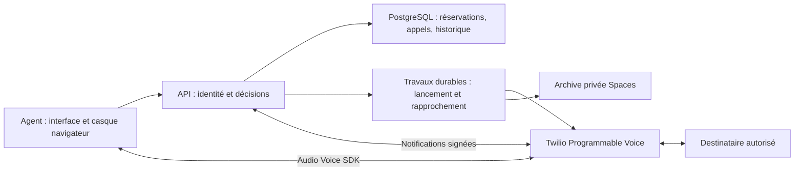

# Téléphonie Unlimited Talks — Twilio Programmable Voice

## Choix courant et état réel

Le parcours retenu utilise Twilio Programmable Voice directement avec l'interface
Unlimited Talks. VICIdial/Asterisk n'est plus un prérequis de cette intégration.
L'[exploration SIP précédente](deployment/telephony/SIP-EXPLORATION.md), ses profils
privés et son image de laboratoire sont conservés comme historique. Ne pas créer
les deux serveurs proposés dans cette exploration pour le parcours Twilio direct.

Le CRM, PostgreSQL, les imports, campagnes, notes, calendrier et rappels restent
le socle. La révision `76f875eacd2f0d0e823a397c3b60141a3a49958f` est déployée,
schéma 7, API `webhooks_only` et `calling_enabled=false`. Le worker de rapprochement
est sain en `recovery_only`, avec sa passerelle de lecture privée vérifiée depuis
son propre conteneur. La SharedKey et son Setting sont créés et leur secret est
privé. Les exceptions publiques sont limitées aux POST téléphoniques précis ;
le reste conserve l'authentification du périmètre. Le test Webhooks Tests de
Twilio a livré une notification signée, acceptée avec une réponse 204. Une Rule
du seul préfixe téléphonique est appliquée ; son Operation a atteint `COMPLETED`,
et `twilio_voice_rule.py check` confirme `verified`. Aucun jeton navigateur réel,
appel ou SMS n'a été émis. Les identifiants de la nouvelle clé
Voice ont été saisis dans un fichier privé du serveur ; sa lecture du numéro de
test a réussi. Une nouvelle application TwiML distincte a ensuite été créée et
vérifiée le 29 octobre 2026. Les trois applications précédentes et les paramètres
des quatre numéros sont restés identiques après création. Aucun numéro n'a été
assigné à cette nouvelle application. Son VoiceUrl est accessible avec signature ;
le mode actuel répond Hangup sans autoriser une numérotation.
Les outils de préparation restent séparés des conteneurs applicatifs.

La prochaine livraison ajoute « Poste d’appel » à l'interface : test local du
microphone et du casque, pour agents et administrateurs. Ce test d'équipement
est préparé dans cette branche et n'est pas encore déployé. Il ne crée aucune
réservation et n'émet aucun jeton SDK. L'appel réel vers le destinataire autorisé
reste une preuve distincte, après intégration de l'audio téléphonique et de
l'archivage privé. Voir [WEB.md](WEB.md#audio-equipment-check).

## Responsabilités cibles

Twilio transporte les médias et établit les communications. Le module applicatif
communications doit décider qui appeler et quand, avec PostgreSQL comme autorité.
Redis/Celery transporte du travail, pas la seule copie des réservations. L'API
ne doit pas lancer indépendamment deux appels pour la même intention après un
délai ou une notification tardive. Chaque commande externe est persistée avant
son effet ; tout résultat incertain est rapproché avant une nouvelle tentative.

Twilio devient le producteur des enregistrements, ensuite archivés dans Spaces
privé avec métadonnées et permissions dans PostgreSQL. Ce choix remplace celui
d'Asterisk dans l'exploration précédente. Le réglage d'enregistrement du trunk SIP
historique n'est pas modifié : il ne sert pas au parcours Programmable Voice.
Les SMS restent une livraison distincte ; aucune messagerie n'est envoyée ici.

## Frontière fournisseur livrée

`backend/app/telephony/twilio_voice.py` fournit des fonctions sans client réseau :

- Profil contrôlé : compte, application TwiML, origine HTTPS canonique et unique
  destinataire approuvé côté serveur. Aucun paramètre navigateur `To` n'est utilisé.
- Jeton Voice SDK de cinq minutes, identité liée à l'agent et à l'intention,
  autorisation sortante pour une seule application TwiML, sans réception d'appels.
- Vérification des formulaires signés avec le validateur du SDK officiel, origine
  et chemin construits depuis la configuration. Les en-têtes Host/Forwarded ne
  décident pas de l'URL signée. Les paramètres supplémentaires et répétés restent
  inclus dans la vérification ; les champs critiques ambigus sont refusés.
- Entrée initiale fixe `/api/telephony/twilio/voice`, correspondant à l'unique
  VoiceUrl d'une application TwiML. Le champ `Intent` est vérifié après la
  signature, sous forme UUID canonique, et doit correspondre à l'identité SDK
  `From`. Cette cohérence ne remplace pas la réservation durable. Le statut parent
  utilise `/api/telephony/twilio/parent-status` et exige un CallSid déjà lié en
  base. Les autres notifications conservent un chemin comprenant l'intention.
- Signature avec une SharedKey dédiée ; identifiant et algorithme doivent
  correspondre au profil. Aucun repli vers le jeton principal du compte. Le SDK
  Python 9.12.0 utilise ici son validateur HMAC_SHA1 ; HMAC_SHA256 est refusé tant
  qu'un validateur officiel compatible n'est pas intégré et vérifié.
- TwiML du premier essai : destination fixe, sonnerie de 20 secondes maximum,
  durée de 180 secondes maximum, enregistrement double canal depuis la réponse,
  notifications de statut/enregistrement et raccrochage final.

**Ces fonctions ne constituent pas une autorisation d'appel.** Un jeton n'est pas
une réservation à usage unique. Une signature authentique n'empêche pas le rejeu.
Le service `telephony/service.py` consomme donc atomiquement une intention non
expirée et vérifie l'administrateur, sa session toujours active et son identité
SDK. La transaction est validée avant de retourner le premier TwiML Dial. Même
une seconde requête avec le même CallSid reçoit seulement Hangup. Les routes
restent indisponibles (503) dans le mode `disabled`, qui reste le défaut des
déploiements locaux. La configuration gérée suivante reçoit les notifications
en mode `webhooks_only`, sans autoriser les appels.

## API contrôlée et historique durable

Le schéma `0007_voice` ajoute intentions, événements immuables et métadonnées des
enregistrements sans réécrire les tables métier. Les sessions ne sont pas une
clé étrangère des intentions : leur révocation ne supprime jamais l'historique.
Un index unique interdit deux intentions actives pour le même utilisateur ; un
autre interdit deux appels de test simultanés vers le même destinataire du compte.

- `POST /api/telephony/test/intents` accepte uniquement un UUID d'idempotence,
  jamais un numéro choisi par le navigateur. Il exige une session administrateur
  récente avec MFA, CSRF et origine valide. La réservation de deux minutes est
  validée en base avant émission du jeton de cinq minutes. La même session peut
  reprendre la même réservation encore disponible ; aucun jeton n'est réémis pour
  une réservation consommée ou une autre session.
- L'annulation libère seulement une réservation non consommée. Ni le navigateur,
  ni un délai local ne peut libérer un appel déjà autorisé. Après une réponse
  perdue, l'intention reste bloquée jusqu'à un résultat terminal du fournisseur
  ou un rapprochement contrôlé. Le worker décrit ci-dessous ne peut créer aucun
  appel ; aucune nouvelle tentative aveugle.
- Au webhook Voice, utilisateur, session et intention sont verrouillés dans cet
  ordre. Une révocation, désactivation, modification de rôle ou expiration entre
  le jeton et l'appel empêche le Dial. La destination et le CallerID sont figés
  dans le profil et l'intention, pas lus depuis les champs du navigateur.
- Les statuts enfants exigent le parent déjà lié, le destinataire et le CallerID
  attendus. Les événements sont dédoublonnés sur leur contenu métier, pas sur des
  champs arbitraires du fournisseur. SequenceNumber et la progression monotone
  empêchent une notification ancienne de réactiver un appel terminé. Le résultat
  détaillé de Dial prime sur le statut générique du parent, même reçu plus tard.
- Les notifications d'enregistrement exigent la source DialVerb et le parent
  déjà lié, conformément au contrat Twilio. Elles peuvent donc arriver avant
  tous les statuts enfants, tout en vérifiant SID, durée et deux canaux. Les
  métadonnées passent à `pending_archive` ; aucune URL de formulaire
  n'est stockée ni téléchargée. Une même RecordingSid ne peut pas être réaffectée.
  Cette réception ne prouve pas encore une copie Spaces ni une lecture audio.
- Les routes POST précises refusent en-têtes ambigus, compression, requêtes avec
  query string et corps supérieurs à 16 Kio, y compris sans Content-Length. Le
  gateway ajoute une limite de taille et de fréquence dédiée. Son adresse vue
  derrière le proxy est partagée : ce plafond est celui du premier essai, à
  mesurer et dimensionner pour les vingt agents.

`COMMUNICATIONS_MODE=controlled_test` exige un profil privé complet via
`VOICE_TEST_PROFILE_FILE`, lié exactement à APP_ORIGIN, à l'environnement staging
et au rôle runtime. Les modes généraux `live` et `production` restent refusés. Le
fichier accepte seulement un propriétaire root/runtime, sans accès aux autres
et sans liens ; son montage en lecture seule est requis. Seuls l'API et le worker
Voice dédié recevront ce profil, dans leurs propres processus ;
le migrateur, les imports et leurs workers restent en `disabled`. Aucun secret
réel n'est monté dans les environnements locaux. Le déploiement géré monte les
fichiers privés préparés sur le serveur.

La nouvelle configuration sépare l'autorisation de recevoir de l'autorisation
d'appeler. `webhooks_only` charge le profil pour vérifier les notifications, mais
refuse toute réservation/émission de jeton et répond Hangup à une demande Voice,
même munie d'un jeton antérieur. Les statuts des appels déjà liés restent recevables.
`recovery_only` est réservé au processus de récupération ; l'API refuse de démarrer
avec ce mode. Seul `controlled_test` arme le chemin de création d'appel.

`POST /api/telephony/twilio/probe` vérifie une signature sans accéder à la base et
retourne 204. Il accepte un formulaire, un test vide ou le protocole JSON
`bodySHA256` validé par le SDK officiel. Ce point de contrôle ne peut créer aucune
intention, instruction Dial ou notification métier. Les en-têtes de signature et
l'identifiant de SharedKey sont exigés, comme sur les routes d'appel.

## Récupération après notification perdue

`backend/app/telephony/reconciliation.py` prépare le worker dédié
`python -m app.telephony.reconciliation`. Son rôle est uniquement de consulter
Twilio pour les intentions déjà consommées, âgées d'au moins vingt secondes.
Une réservation sans appel autorisé ne peut pas être consommée par ce worker.
La réservation durable reste la source de reprise après un arrêt du processus.

- La lecture est limitée au compte configuré, à un parent déjà lié, à la liste
  de ses enfants et à l'enfant attendu. GET seulement, origine Twilio fixe,
  certificat TLS vérifié, aucun suivi de redirection et réponse limitée à 64 Kio.
  Les lectures ont un délai maximal de cinq secondes chacune. Les URL présentes
  dans une réponse ne sont jamais suivies.
- Chaque enfant doit appartenir au parent, au CallerID et au destinataire figés,
  avec direction `outbound-dial`. Le parent doit correspondre à l'identité SDK
  originale. Une page incomplète ou plusieurs enfants imposent une vérification.
  Un enfant déjà lié est relu directement même s'il manque dans la liste.
- La réservation n'est libérée que si le parent et tout enfant attendu sont
  terminés. Une réponse 404, 429, une coupure, une identité différente ou un état
  encore actif conserve la réservation. Il n'existe aucun repli vers une
  expiration locale d'un appel consommé.
- Le réseau est consulté hors transaction PostgreSQL. À la réception du résultat,
  une nouvelle transaction verrouille et vérifie l'intention. Un enfant associé
  entre-temps invalide une observation qui ne le connaissait pas ; un webhook
  ayant déjà terminé l'appel garde son autorité. Deux workers peuvent lire le
  même appel, mais un seul applique sa récupération.
- Les événements de rapprochement sont dédoublonnés sur les états observés, sans
  répéter une ligne d'historique à chaque passage inchangé. Les compteurs et codes
  d'échec sont bornés et expurgés : aucun numéro, secret ou corps Twilio dans les
  journaux. Les métadonnées de conversation restent dans PostgreSQL.

Le processus est séparé des workers d'import et de l'API. Il traite au plus vingt
intentions par passage avec quatre lectures concurrentes maximum, puis attend
dix secondes. Un heartbeat est écrit seulement après un passage sans échec ; le
contrôle d'exploitation doit tenir compte du temps maximal d'un lot. Ces bornes
ne prouvent pas une capacité audio ni le délai de connexion de vingt agents.

Le service `voice-reconciler` est déployé avec son image attestée, un profil en
lecture seule et une mémoire bornée. Il reste inactif sans accès au fournisseur
dans la configuration locale.
Le mode géré `recovery_only` exige la passerelle privée et son secret distinct ;
aucun repli vers une sortie Internet directe. Il devra être sain avant d'armer
le premier appel. Les tests métier utilisent des réponses synthétiques et un vrai
PostgreSQL jetable ; aucun appel réel n'a été interrogé ou relancé.

## Connexion privée et signature

`scripts/twilio_voice_signing.py` prépare une SharedKey et un Setting HMAC_SHA1
inactif. Les POST sont journalisés et synchronisés avant envoi. Une réponse de clé
perdue impose un examen, car son secret n'est récupérable qu'à la création ; aucun
deuxième POST automatique. Une création de Setting incertaine est rapprochée par
lecture, sans duplication. L'outil n'autorise aucune écriture de Rule ni modification
d'une ressource existante. Le profil assemblé reste hors de Git.

`scripts/prepare_voice_runtime.py` exporte les montages root:groupe10001 en mode
0440, en refusant de remplacer un contenu différent. Le worker reçoit également
un secret de passerelle distinct ; les workers d'import ne le reçoivent pas.

La passerelle Caddy écoute uniquement sur `172.30.8.1:8112`. Une règle UFW autorise
l'accès depuis le pont Docker attendu, avec contrôle du sous-réseau, de son
interface et de son identité. La route exige son secret et un GET vers le compte
Twilio figé : lecture d'une CallSid ou liste de ses enfants, avec filtre parent et
PageSize exacts. Toute liste globale, autre compte, autre requête ou autre méthode
est refusée. L'upstream HTTPS est toujours `api.twilio.com`, avec TLS vérifié ; le
corps et les en-têtes de substitution de méthode ne sont pas transmis. Le blocage
WAN général des conteneurs est conservé.

Un contrôle réel a vérifié la connexion à Twilio avec une CallSid inexistante et
une liste d'enfants vide, ainsi que le refus du POST et d'une requête non authentifiée.
Il ne constitue pas une validation d'appel ou une lecture d'historique client.

Le helper valide le proxy avant rechargement, garde une sauvegarde privée et
restaure la configuration si le rechargement échoue. L'ordre de démarrage de Caddy
est placé après Docker pour le listener du pont privé. Le helper `enable-hooks`
refuse toute ouverture avant une API saine en `webhooks_only`, appels explicitement
désactivés. Son exception publique est limitée aux routes POST téléphoniques
précises ; l'import d'authentification humaine est préservé pour le reste.

`scripts/twilio_voice_delivery_test.py` envoie uniquement un test à `/probe`,
avec le Setting vérifié. Une réponse API 200 ne suffit pas : le reçu privé doit
prouver `result.outcome=DELIVERED` et `result.response=204`. La livraison réelle
du 31 octobre a passé ce contrôle. Aucun appel ni notification métier n'est créé.

`scripts/twilio_voice_rule.py` sépare préparation, création et vérification. Il
exige ce reçu récent et autorise uniquement la Rule du préfixe
`https://staging.unlimitedtalkapp.com/api/telephony/twilio/`, avec le Setting dédié
à 100 %. DEFAULT, PATCH, DELETE et toute autre origine sont refusés. Le POST est
journalisé et synchronisé avant envoi ; une réponse perdue se rapproche par
lecture de la Rule et de son Operation, sans deuxième création. `Retry-After`
est respecté et seule une Operation `COMPLETED` confirme la propagation.

Le reçu privé de la Rule permet au vérificateur de signature de reconnaître
uniquement cette nouvelle ressource, avec son empreinte et son paramétrage exacts.
Les empreintes des anciennes Rules restent inchangées et vérifiées ; aucune
exception globale n'est introduite dans le contrôle d'intégrité.

La première tentative de déploiement avait échoué : une copie root 0600 du
fichier Nginx empêchait sa lecture par le gateway sans privilèges. Le retour
automatique a conservé l'application. Les permissions du template et du fichier
de release ont été corrigées à 0644, sans changement de contenu. Le même fichier
a passé `nginx -t` dans l'image épinglée, puis le redéploiement de la même image
attestée a réussi. Le déployeur source impose désormais 0644 pour cette seule
configuration statique sans secret, avec un test de régression ; cette évolution
source sera installée lors de la prochaine livraison de l'outil hôte.

## Ordre de déploiement

La livraison de compatibilité suivante reste au schéma 7 et accepte le futur
schéma additif `0008_recordings`. Elle doit être déployée avant l'archivage durable
afin de permettre un retour à cette image sans supprimer les enregistrements.
Elle ne crée aucune table, ne change aucun appel ni réglage Twilio et conserve
les appels désactivés. Le schéma 8 et le worker seront livrés séparément après
validation de cette version sur le serveur.

La version de compatibilité est `a8316b7b42850d95b2440b370077813a59563e22`,
publiée et attestée depuis main. Le déployeur du schéma 8 refuse une migration
depuis une autre version du schéma 7. La branche `feature/recording-archive`
prépare la livraison fonctionnelle ; elle ne doit pas remplacer main avant la
vérification de la compatibilité réellement déployée.

## Archivage privé préparé — schéma 8

Cette branche ajoute une file PostgreSQL `voice_archive_jobs`, son index de
travaux dus et les index d'historique/enregistrements en attente. Les tables
Voice existantes ne sont pas réécrites. La migration récupère les enregistrements
déjà en attente ; le worker récupère aussi ceux reçus par une ancienne API après
un retour arrière. Une réservation de travail possède un jeton et un bail de
cinq minutes ; son expiration autorise une nouvelle copie idempotente du fichier,
jamais un second appel ou la libération d'une conversation incertaine.

Le worker dédié prend un seul fichier à la fois, libère sa connexion PostgreSQL
avant les accès réseau, puis vérifie sous verrou le même travail avant de valider
la copie. Les reprises et délais exponentiels restent en base. Les erreurs ne
conservent que des codes contrôlés. La terminaison met à jour le fichier, le
travail et l'événement d'archivage dans une transaction unique. Une tentative
ancienne ne peut pas terminer ou faire échouer un travail repris entre-temps.

Le lecteur fournisseur accepte seulement GET des métadonnées du RecordingSid
attendu et GET du WAV double canal correspondant, dans le compte configuré. Il
ignore les URL des formulaires et réponses, vérifie le compte, l'appel parent,
la source DialVerb, la durée et les deux canaux. Pas de redirection ni de repli
mono. Le premier format pris en charge est WAV PCM 16 bits, 8 kHz, deux canaux,
avec une taille maximale de 24 Mio. La lecture réelle d'un Recording Twilio
restera à prouver pendant l'appel contrôlé ; les tests actuels utilisent des
métadonnées et un WAV synthétiques.

Spaces reçoit une clé incluant intention, RecordingSid et SHA-256. Le fichier
est privé et relu pour vérifier ses octets avant la validation PostgreSQL. Une
coupure après l'upload permet de refaire la même copie sans créer un deuxième
enregistrement métier. Aucun fichier Twilio n'est supprimé par cette livraison.
Le contrôle effectué sur le serveur avec un WAV synthétique a prouvé l'upload,
la relecture intègre et le refus d'une lecture anonyme ; le fichier de contrôle
a été supprimé.

L'interface prépare l'historique paginé des appels et le lecteur audio dans
« Poste d’appel ». L'agent accède à ses appels, l'admin à tous. La lecture passe
par `/api/telephony/recordings/{sid}/audio`, après authentification et vérification
de propriété, sans URL Spaces/Twilio publique. Le lecteur ne précharge pas les
fichiers. Le serveur vérifie le SHA-256 avant de répondre, prend en charge une
plage HTTP unique pour le déplacement audio et borne les lectures simultanées.
Une copie incomplète ou modifiée ne peut pas être jouée. Les téléchargements
ne gardent aucune transaction PostgreSQL ouverte.

Avant la livraison fonctionnelle, le helper hôte doit activer explicitement
`upgrade-recording-gateway`. Il accepte uniquement l'ancien fragment privé exact
et son évolution vers les deux GET Recording, valide le candidat complet avec
Caddy, sauvegarde et restaure en cas d'échec. La sortie WAN générale reste bloquée.
Le template ajoute seulement le worker `voice-archiver`, avec le profil privé et
la configuration Spaces en lecture seule ; les appels restent désactivés.

La version de compatibilité `6e2c3c97a418f3bebde690f0c206e90ccbebfa6c`, puis
la migration additive du schéma 7 ont déjà été déployées et vérifiées. Cette
livraison conserve le schéma 7 ; aucun downgrade ni nouvelle migration métier.

1. Valider cette branche dans Foundation CI, puis publier depuis main l'image
   testée et attestée. Préparer les templates et le déployeur revus sur le serveur.
2. Déployer cette image par le workflow, puis vérifier `webhooks_only`,
   `calling_enabled=false` et le worker de récupération sain. Un retour arrière
   restaure l'ancienne application et arrête le nouveau worker sans toucher au schéma.
3. Exposer les POST précis au travers de BasicAuth, puis tester la signature
   depuis Webhooks Tests avec le Setting inactif et vérifier la réponse 204.
4. Appliquer la Rule limitée au nouveau préfixe et vérifier sa propagation.
   Armer les appels reste une opération distincte, après raccordement et
   vérification de l'interface, des notifications et du rapprochement.

Les tests HTTP/PostgreSQL utilisent une base jetable, des profils et signatures
synthétiques et un serveur local dans un processus séparé. Ils n'activent pas le
profil réel du conteneur déployé et ne prouvent ni l'acceptation du jeton par Twilio
ni l'audio. L'application existante n'est jamais utilisée comme base de test.

## Informations nécessaires avant l'essai réel

Le 29 octobre 2026, l'utilisatrice a désigné le téléphone d'Omar comme destinataire
de l'essai et confirmé que le compte sert uniquement à Unlimited Talks. Le numéro
complet autorisé est conservé dans le plan privé du serveur, pas dans ce dépôt.
Une lecture fournisseur avec les identifiants déjà configurés pour l'ancienne
application a confirmé l'existence de son application TwiML et de son numéro.
Le compte correspond à celui du numéro réservé aux tests ; les deux numéros sont
distincts. Cette lecture ne prouve pas un appel actuel ni l'état du serveur ancien.

1. Utiliser uniquement le destinataire de test confirmé. Aucun numéro de la
   base importée ne sert au test. Son pays doit être permis dans le compte retenu.
2. Conserver le compte Unlimited Talks confirmé. Une clé Standard peut
   signer les jetons SDK mais possède des droits plus larges qu'une clé Restricted.
   Créer une clé distincte et une nouvelle application TwiML pour la nouvelle
   version ; préserver les identifiants, l'application et les routes de l'ancienne.
   Si d'autres services sont ajoutés, préférer un sous-compte dédié. Vérifier alors ses
   propres limites, numéros et capacités ; ne pas supposer qu'il hérite des 5 CPS.
3. Préparer la clé Standard US1 et l'application TwiML dans ce compte, puis une
   SharedKey de webhook et une règle limitée exactement au nouveau préfixe URL.
   Ne pas appliquer une règle DEFAULT à tout le compte. Stockage privé, saisie
   invisible, aucune valeur secrète dans le chat, Git ou navigateur.

La clé actuelle en lecture seule et le mot de passe SIP ne satisfont pas ces
besoins. Aucun déplacement de numéro vers un autre compte ne doit être fait sans
vérification préalable de son usage et de son routage. La validation statique du
profil ne prouve pas l'appartenance de la clé, du numéro ou de l'application : un
contrôle fournisseur et l'appel réel devront confirmer ces associations.

### Saisie de la clé Voice

`scripts/twilio_voice_preflight.py` réutilise les contrôles de fichiers privés de
`staging_twilio_preflight.py`. Les deux fichiers doivent être installés côte à côte
dans un dossier root privé. Les actions sont séparées :

- `plan` reçoit sur l'entrée standard uniquement le destinataire autorisé et
  l'origine HTTPS ; il lie le plan au compte et au numéro déjà configurés. Il
  refuse de remplacer un plan existant. L'origine actuelle est bornée au domaine
  de la nouvelle application ; un changement de domaine demande une revue du code.
- `store` demande invisiblement le SID SK et le secret de la nouvelle clé Standard
  US1, avec confirmation. Il refuse la clé Restricted déjà configurée et tout
  remplacement. Le fichier root 600 reste hors des conteneurs et du dépôt.
- `check` fait seulement un GET du numéro PN sélectionné avec la nouvelle clé,
  sans redirection. La réponse vérifie compte, numéro et capacité voix ; le rapport
  masque les secrets et numéros complets. Il ne prétend pas vérifier le type
  Standard, l'acceptation d'un jeton SDK ou un appel. Une clé Restricted dotée du
  droit de lecture pourrait aussi réussir ce GET : choisir Standard en console
  reste nécessaire, puis prouver l'acceptation SDK lors de l'essai contrôlé.

Ces actions ne créent aucune application TwiML ni SharedKey, ne modifient aucun
routage et n'activent aucun appel. Ne pas réutiliser les clés de l'ancienne version.

### Provisionnement de l'application TwiML

`scripts/twilio_voice_application.py`, installé avec les deux outils précédents,
sépare `prepare`, `apply` et `check`. Le nom est `unlimited-talk-voice`, sans suffixe
d'environnement. VoiceUrl et StatusCallback utilisent les deux routes fixes
ci-dessus, en POST. CNAM payant et connexion publique depuis d'autres comptes
sont désactivés ; aucune route SMS ni repli vers l'ancienne application.

`prepare` lit l'inventaire du compte, vérifie le numéro de test et refuse un nom
déjà occupé. Il conserve dans un journal root 600 les empreintes de toutes les
propriétés des applications et numéros existants, hormis les dates. `apply` écrit
et synchronise l'état `requested` avant l'unique POST de création autorisé. Une
réponse perdue laisse ce résultat incertain ; les invocations suivantes font
uniquement un rapprochement en lecture, sans deuxième création. Un nom ambigu,
une modification concurrente ou une configuration différente impose une revue.

La vérification relit la nouvelle application par son SID, vérifie ses paramètres
et compare toutes les ressources précédentes. Aucun endpoint d'appel, modification
de numéro ou modification d'application existante n'est autorisé par le transport.
Un verrou exclusif protège les exécutions concurrentes ; les journaux sont écrits
par remplacement atomique et synchronisation disque. Le SID AP vérifié reste dans
`/etc/unlimited-talk-staging/twilio-voice-application.json`, hors du dépôt.

La création du conteneur de configuration TwiML ne prouve pas les jetons SDK ni
l'audio. La réception signée et le rapprochement ont ensuite été livrés et
vérifiés séparément. Leur preuve ne permet pas encore de distribuer un jeton réel
ou d'autoriser un appel sans le parcours navigateur et l'archivage privés prêts.

## Livraison de bout en bout à réaliser

Le périmètre comprend désormais l'affectation explicite des agents aux appels
entrants et le suivi des appels non traités dans « Appels entrants ». Le
[contrat d'exploitation](ARCHITECTURE.md#inbound-operating-contract--scope-added-31-october-2026)
décrit les règles acceptées de distribution, d'attente et de messagerie ainsi
que les intégrations encore nécessaires. Cette logique doit partager les réservations d'agent avec le
composeur sortant ; elle n'est pas activée par la livraison de signature actuelle.

1. Conserver la réception signée et le rapprochement déjà déployés ; vérifier
   leur santé après chaque évolution avant d'armer le premier appel. Une
   intention au résultat incertain ne s'expire pas.
2. Maintenir l'exception publique limitée aux POST précis et conserver
   MFA/permissions sur toutes les opérations humaines.
3. Garder les contrôles de propagation de Rule, de livraison et
   d'intégrité des configurations existantes dans la procédure d'exploitation.
4. Interface française : préparation du casque, appel, état réel, raccrochage et
   erreurs lisibles. Mettre à jour CSP et Permissions-Policy selon les domaines
   du SDK et tester depuis les réseaux réels. Ne pas désactiver globalement CSP.
5. Événements dupliqués, tardifs et désordonnés : progression monotone de l'appel,
   aucun retour d'un état terminal à un état actif ; rapprochement après coupure.
6. Archivage durable : charger le recording par SID attendu depuis les endpoints
   Twilio autorisés, jamais une URL arbitraire du formulaire. Vérifier métadonnées,
   deux canaux et copie privée avant suppression du fournisseur. Reprise après
   échec d'upload et contrôle de lecture agent/admin ; aucun lien fournisseur public.
7. Enchaînement, campagnes et rappels seulement après cette preuve : réservations
   canoniques globales, pas de doublon entre campagnes, deux tentatives/jour local,
   intervalle de deux heures, plages de campagne, exclusions et rappels attribués.
   Pause/arrêt, changement de campagne et formulaire RDV doivent arbitrer l'état
   réel de l'agent avant chaque lancement ; un RDV non sauvegardé conserve l'attente.
8. Monter progressivement jusqu'à vingt agents avec médias réels, pannes,
   raccrochages et enregistrements. Mesurer délai entre conversations, délai de
   connexion après réponse, taux de réponse, erreurs et coût. Aucun test simulé
   de cette livraison ne prouve la capacité ou la qualité audio.

Le réseau des conteneurs bloque actuellement les sorties WAN arbitraires. Les
flux fournisseur nécessaires devront passer par une sortie explicitement bornée,
avec vérification TLS. La nouvelle configuration des webhooks et des secrets doit
être prête avant toute ouverture. L'interface ne doit pas proposer de bouton
fonctionnel tant que ces prérequis et la réservation durable ne sont pas validés.

## CPS et attente des agents

La console du compte consulté indique 5 CPS. Cela concerne les appels créés par
l'API REST ; les appels `<Dial>` et entrants ne partagent pas cette limitation.
Le premier essai navigateur/TwiML ne démontre donc pas la capacité de lancement
d'un composeur REST à vingt agents. Ni 5 CPS, ni vingt comptes utilisateurs ne
prouvent vingt conversations ni une attente minimale. Ne pas engager une nouvelle
augmentation payante sans vérifier le compte, son tarif et le parcours final.

Le taux de réponse et la durée des conversations déterminent les besoins de
lancement. L'AMD peut introduire un délai ou classer une personne à tort. Son mode
et ses seuils devront être mesurés ; aucun objectif de zéro attente n'est promis.

## Références officielles

- [Voice SDK](https://www.twilio.com/docs/voice/sdks/javascript).
- [Applications TwiML](https://www.twilio.com/docs/usage/api/applications).
- [Notifications d'enregistrement Dial](https://www.twilio.com/docs/voice/twiml/dial#recordingstatuscallback).
- [Jetons SDK : clés Main/Standard, pas Restricted](https://www.twilio.com/docs/iam/access-tokens).
- [Signatures dédiées SharedKey](https://www.twilio.com/docs/usage/webhooks/webhook-shared-keys).
- [Validation des notifications](https://www.twilio.com/docs/usage/webhooks/webhooks-security).
- [CPS et Calls API](https://www.twilio.com/docs/voice/api/call-resource).
- [Détection des répondeurs](https://www.twilio.com/docs/voice/answering-machine-detection).

La correction d'espacement des boutons du contact est livrée dans la révision
`90e3cfc58a7a216cc79307c990e1440e14756fba`, avec l'API contrôlée.
