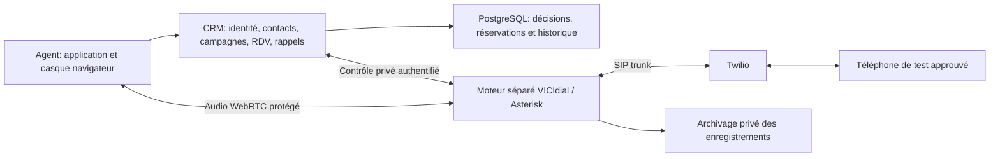

# Telephony integration proof

## Actual state and next delivery

The CRM/calendar/callback application is functional on managed staging. Its
communications mode remains disabled, and its runtime database guard rejects
live mode. No Asterisk/VICIdial service or Twilio credential configuration was
found on the application host during this preparation. No calls, messages,
number purchases, trunk creation, routing changes or paid compute provisioning
are performed by this preparation.

The next proof connects one controlled agent and one explicitly approved test
phone using a selected Twilio number, on an isolated telephony engine. It must
prove real audio and application control before loading customer campaigns or
claiming support for twenty concurrent agents. Synthetic tests validate code
boundaries; they do not validate SIP, real audio, answer detection or capacity.

The installation assessment, proposed host sizing, image-build procedure and
unverified deployment gates are in [the installation dossier](deployment/telephony/INSTALLATION.md).
No deployable image has been produced by that assessment.

## Ownership and topology



The application remains the business authority. The telephony engine owns live
channels, media, dialing mechanics and its own internal database. It does not
receive the CRM PostgreSQL password. Telephony credentials, administrative APIs,
AMI/ARI and the engine's database do not belong in the browser or public CRM API.
SIP trunk authentication is separate from a Twilio REST API key.

VICIdial/Asterisk remains the intended single dialing engine, subject to proof.
The application must not independently originate the same customer call via a
second Twilio REST dialer. A provider read-only check is not such a dialer.

## Private Twilio read-only preparation

Install `scripts/staging_twilio_preflight.py` as root700 at
`/root/staging-twilio-preflight.py`. Its CLI commands are:

```sh
python3 /root/staging-twilio-preflight.py store
python3 /root/staging-twilio-preflight.py check
```

The first command invisibly collects the selected account SID (`AC…`), restricted
API key SID (`SK…`), secret plus confirmation, phone-number SID (`PN…`) and expected
international caller number. It creates only the root-owned mode600 file
`/etc/unlimited-talk-staging/twilio-preflight.json`, in the existing private host
configuration directory, and refuses overwrite or symbolic links. These values
must not be pasted into chat, Git, workflow inputs, command arguments or logs.
The file is not mounted into application containers.

Use an API key named `unlimited-talk-staging-readonly`, type **Restricted**, region
**United States (US1)**, with only
`twilio/phone-numbers/active-numbers/read`. Select the intended account/subaccount
in the console before creating the key or copying account/number identifiers.
The console's secret is available at creation; store it in the team's password
manager and enter it using the private server prompt.

`check` makes one HTTPS **GET** for the configured IncomingPhoneNumber, with
certificate verification, a fixed Twilio host/path, strict SID validation,
bounded response size, timeout and refused redirects. It verifies the response's
account, number SID and expected E.164 number, and reports announced Voice/SMS
capabilities plus whether a SIP trunk or inbound route is already associated.
It never displays credentials, the full number or an inbound webhook URL. The
client exposes no call/message/write operation. Unit tests exercise the boundary
without contacting Twilio. The operator must verify the key's granted scope in
the console: successful read access alone does not prove it has no wider grants.

A successful read does **not** prove account billing status, geographic dialing
permissions, outgoing caller-ID policy, SIP trunk authentication, reachable media,
callback delivery, recording access or usable audio. Those require later checks.
Existing inbound routes remain unchanged. Parent Auth Tokens and broad Main API
keys are not needed for this number-resource read.

Official references:

- [Create API keys in the Twilio console](https://www.twilio.com/docs/iam/api-keys/keys-in-console).
- [Restricted keys](https://www.twilio.com/docs/iam/api-keys/restricted-api-keys).
- [Phone-number read permission mapping](https://docs-resources.prod.twilio.com/documents/Twilio_Restricted_API_Keys_Permissions_-_Numbers_Permissions.pdf).
- [IncomingPhoneNumber resource](https://www.twilio.com/docs/phone-numbers/api/incomingphonenumber-resource).
- [Elastic SIP Trunking](https://www.twilio.com/docs/sip-trunking).

## Engine installation decision: verify before provisioning

The vendor's site currently lists ViciBox 12.0.2 as stable, and 13.0.0-beta4 as a
release candidate with a planned future stable release. The current vendor manual
also identifies urgent PHP fixes for older installations. Its 13.0 documentation
uses openSUSE Leap 16.0; the stable 12 server page lists Leap 15.6, which openSUSE
states reached end of maintenance in April 2026. These are time-sensitive findings,
not approval to deploy an unpatched image or a beta as a production baseline.
Recheck current release/support and vendor fixes when choosing the installation.

DigitalOcean custom images require a supported disk-image format, BIOS boot,
correct cloud-init and SSH configuration; the ViciBox ISO cannot simply be selected
as an existing Ubuntu Droplet image. Validate the complete supported installation
and boot/network path, or a vendor-supported maintained deployment, before asking
for a new paid host. No unreviewed install script is run on the application host.

Sources checked on 2026-10-28:

- [Official ViciBox server releases](https://vicibox.com/server/).
- [Current ViciBox manual and security errata](https://docs.vicibox.com/en/latest/).
- [openSUSE maintenance notice](https://news.opensuse.org/2026/04/01/leap-15-eol/).
- [DigitalOcean custom-image requirements](https://docs.digitalocean.com/products/custom-images/how-to/upload/).
- [DigitalOcean image limits](https://docs.digitalocean.com/products/custom-images/details/limits/).

## Recording ownership decision

Use the separate VICIdial/Asterisk engine as the recording producer. Keep the
Twilio trunk's Call Recording setting at **Do Not Record** for this architecture.
The application presents and authorizes playback; browser capture is not the
recording authority. Private Spaces is the archive, with per-call metadata in
PostgreSQL, agent-own/admin-all access and short-lived authorized playback links.

Configure and prove recording on the actual supported engine build before live
activation. Verify both speakers, correct start/stop boundaries and the stable
original call UUID association, including when the agent has moved to a later
call. Use trusted generated identifiers for file paths, never raw caller/name
input. Wait for finalized files, upload with retries and verify the private copy
before removing a local spool file. Expose pending/failed archive state accurately;
a successful call does not prove its recording was archived.

The controlled audio test must include restart/upload-failure recovery and denied
playback by another agent. No engine or recording pipeline is installed by this
decision alone. [Asterisk MixMonitor](https://docs.asterisk.org/Latest_API/API_Documentation/Dialplan_Applications/MixMonitor/)
is the upstream capability reference; use the installed engine's supported native
recording controls and options, verified in the proof.

## Required integration proof

1. Prove HTTPS agent control, browser audio transport and the selected Twilio SIP
   trunk with one approved destination. Check outbound and inbound audio, hangup,
   caller ID, late/duplicate events and channel recovery. No customer list is used.
2. Map one CRM user, campaign, canonical contact and stable call UUID to their
   engine session/lead/channel identifiers. Use the recorded original call ID for
   every disposition and note, even after a later call starts.
3. Prove a synchronous, authenticated, fail-closed pre-origination gate for every
   attempted outbound call. The gate must atomically reserve the canonical contact
   and apply global blocks, active assignments, calling hours and attempt limits.
   A post-call URL notification is evidence after an event, not a pre-call lock.
4. Two simultaneous requests for the same contact in different campaigns must
   never produce two call originations. Enqueuing leads in a predictive hopper is
   insufficient unless every actual dial path is guarded. Prove the gate on the
   installed engine revision, including manual, callback and automatic paths.
5. The agent controller must respect pause/stop, an active call, and an open RDV
   form. Failed RDV saves keep the hold. Do not equate a pause API acknowledgment
   with immediate physical call suspension; reconcile the actual engine state.
6. Agent-owned due callbacks precede eligible ordinary campaign contacts, wait
   for their owner and remain reserved across campaigns. Campaign switching must
   not reassign them. Enforce the global two attempts/local day and two-hour gap
   for callback attempts too. No-answer/machine attempts count; normal retry
   eligibility returns to the queue tail. Machines disconnect without a message.
7. Persist an external-command intent before side effects. Correlate acknowledgments
   and provider/channel identifiers. After a timeout, reconcile before retrying an
   origination. A generic Celery retry must not silently place a second call.
8. Verify private recording ingestion, metadata association and authorization:
   agent's own calls versus admin's all. Downloadable provider URLs/credentials
   do not go into public pages or shared buckets. Verify inbound voicemail and
   shared manual-callback handling separately from scheduled callback ownership.
9. Only after these pass, prove the requested concurrency with twenty controlled
   agent sessions, real media, failure recovery and measured answer/connect timing.
   Record the tested dialing/AMD mode and resources; account count or RAM is not
   evidence of usable voice capacity.

[The official agent API](https://vicidial.org/docs/AGENT_API.txt) describes remote
pause/resume, manual dial, hangup and dispositions for agent sessions. Its pause
semantics are deferred when a call is active. These functions are candidates for
an adapter, not proof that the custom interface, browser phone, state arbitration
and pre-dial gate already work together. API credentials must be sent over HTTPS
in private requests and kept out of URL/access logs.

[Official Asterisk WebRTC configuration](https://docs.asterisk.org/Configuration/Channel-Drivers/SIP/Configuring-res_pjsip/) provides the media configuration
reference. Pin versions and review the installed distribution's supported SIP
stack rather than copying configuration for a different release.

## Private SIP credential preparation

The root operator helper also supports `store-sip` and `check-sip`. Before entry,
an operator prepares `/etc/unlimited-talk-staging/twilio-sip-plan.json`, bound to
the account and test number already verified by the read-only preflight. The plan
requires encrypted trunking and Asterisk-owned recordings. It authorizes credential
storage only, with no call destination or origination capability.

`store-sip` prompts privately for the existing Credential List username and SIP
password, with confirmation. It creates `twilio-sip-profile.json` in the same
private directory, mode 0600, refusing overwrite. These credentials are separate
from the read-only API key. `check-sip` validates the stored profile and reports
redacted metadata only; it does not prove SIP authentication, engine configuration
or audio. No credentials belong in GitHub, chat or application logs. The maintained
engine installation and an explicitly approved test destination remain prerequisites
for a live proof.

## Delivery boundary

This preparation adds a read-only operator tool, its tests, this proof contract
and the queued contact-button spacing correction. It adds no schema migration or
live call interface. The UI correction is held for the next substantive application
delivery, as requested; no separate deployment is requested for spacing alone.
The installed helper can be used without switching the running application.
