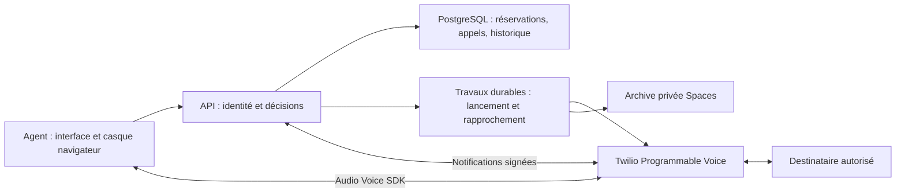

# Téléphonie Unlimited Talks — Twilio Programmable Voice

## Choix courant et état réel

Le parcours retenu utilise Twilio Programmable Voice directement avec l'interface
Unlimited Talks. VICIdial/Asterisk n'est plus un prérequis de cette intégration.
L'[exploration SIP précédente](deployment/telephony/SIP-EXPLORATION.md), ses profils
privés et son image de laboratoire sont conservés comme historique. Ne pas créer
les deux serveurs proposés dans cette exploration pour le parcours Twilio direct.

Le CRM, PostgreSQL, les imports, campagnes, notes, calendrier et rappels restent
le socle. Les communications de l'application déployée sont toujours désactivées.
Cette livraison ajoute uniquement une frontière fournisseur hors réseau, le SDK
Python officiel et ses tests. Aucun routeur téléphonique, migration, accès public
aux webhooks, jeton navigateur réel ou numérotation n'est activé. Aucune nouvelle
clé n'a été collectée, aucun paramètre Twilio ni routage de numéro modifié.
Un outil de préparation privée des identifiants Voice est disponible séparément
des conteneurs ; il ne fait qu'une lecture du numéro sélectionné lorsqu'on lui
demande de vérifier la connexion.

## Responsabilités cibles

Twilio transporte les médias et établit les communications. Le module applicatif
communications doit décider qui appeler et quand, avec PostgreSQL comme autorité.
Redis/Celery transporte du travail, pas la seule copie des réservations. L'API
ne doit pas lancer indépendamment deux appels pour la même intention après un
délai ou une notification tardive. Chaque commande externe est persistée avant
son effet ; tout résultat incertain est rapproché avant une nouvelle tentative.

Twilio devient le producteur des enregistrements, ensuite archivés dans Spaces
privé avec métadonnées et permissions dans PostgreSQL. Ce choix remplace celui
d'Asterisk dans l'exploration précédente. Le réglage d'enregistrement du trunk SIP
historique n'est pas modifié : il ne sert pas au parcours Programmable Voice.
Les SMS restent une livraison distincte ; aucune messagerie n'est envoyée ici.

## Frontière fournisseur livrée

`backend/app/telephony/twilio_voice.py` fournit des fonctions sans client réseau :

- Profil contrôlé : compte, application TwiML, origine HTTPS canonique et unique
  destinataire approuvé côté serveur. Aucun paramètre navigateur `To` n'est utilisé.
- Jeton Voice SDK de cinq minutes, identité liée à l'agent et à l'intention,
  autorisation sortante pour une seule application TwiML, sans réception d'appels.
- Vérification des formulaires signés avec le validateur du SDK officiel, origine
  et chemin construits depuis la configuration. Les en-têtes Host/Forwarded ne
  décident pas de l'URL signée. Les paramètres supplémentaires et répétés restent
  inclus dans la vérification ; les champs critiques ambigus sont refusés.
- Signature avec une SharedKey dédiée ; identifiant et algorithme doivent
  correspondre au profil. Aucun repli vers le jeton principal du compte. Le SDK
  Python 9.12.0 utilise ici son validateur HMAC_SHA1 ; HMAC_SHA256 est refusé tant
  qu'un validateur officiel compatible n'est pas intégré et vérifié.
- TwiML du premier essai : destination fixe, sonnerie de 20 secondes maximum,
  durée de 180 secondes maximum, enregistrement double canal depuis la réponse,
  notifications de statut/enregistrement et raccrochage final.

**Ces fonctions ne constituent pas une autorisation d'appel.** Un jeton n'est pas
une réservation à usage unique. Une signature authentique n'empêche pas le rejeu.
Avant de retourner le TwiML, le futur service doit atomiquement consommer une
intention non expirée et vérifier l'utilisateur, sa session toujours active, son
identité SDK et le CallSid déjà lié. Les notifications doivent être liées à cette
intention et aux identifiants d'appel/enregistrement attendus. Les fonctions sont
volontairement inaccessibles depuis les routes actuelles tant que ce service et
ses transactions ne sont pas livrés.

## Informations nécessaires avant l'essai réel

Le 29 octobre 2026, l'utilisatrice a désigné le téléphone d'Omar comme destinataire
de l'essai et confirmé que le compte sert uniquement à Unlimited Talks. Le numéro
complet autorisé est conservé dans le plan privé du serveur, pas dans ce dépôt.
Une lecture fournisseur avec les identifiants déjà configurés pour l'ancienne
application a confirmé l'existence de son application TwiML et de son numéro.
Le compte correspond à celui du numéro réservé aux tests ; les deux numéros sont
distincts. Cette lecture ne prouve pas un appel actuel ni l'état du serveur ancien.

1. Utiliser uniquement le destinataire de test confirmé. Aucun numéro de la
   base importée ne sert au test. Son pays doit être permis dans le compte retenu.
2. Conserver le compte Unlimited Talks confirmé. Une clé Standard peut
   signer les jetons SDK mais possède des droits plus larges qu'une clé Restricted.
   Créer une clé distincte et une nouvelle application TwiML pour la nouvelle
   version ; préserver les identifiants, l'application et les routes de l'ancienne.
   Si d'autres services sont ajoutés, préférer un sous-compte dédié. Vérifier alors ses
   propres limites, numéros et capacités ; ne pas supposer qu'il hérite des 5 CPS.
3. Préparer la clé Standard US1 et l'application TwiML dans ce compte, puis une
   SharedKey de webhook et une règle limitée exactement au nouveau préfixe URL.
   Ne pas appliquer une règle DEFAULT à tout le compte. Stockage privé, saisie
   invisible, aucune valeur secrète dans le chat, Git ou navigateur.

La clé actuelle en lecture seule et le mot de passe SIP ne satisfont pas ces
besoins. Aucun déplacement de numéro vers un autre compte ne doit être fait sans
vérification préalable de son usage et de son routage. La validation statique du
profil ne prouve pas l'appartenance de la clé, du numéro ou de l'application : un
contrôle fournisseur et l'appel réel devront confirmer ces associations.

### Saisie de la clé Voice

`scripts/twilio_voice_preflight.py` réutilise les contrôles de fichiers privés de
`staging_twilio_preflight.py`. Les deux fichiers doivent être installés côte à côte
dans un dossier root privé. Les actions sont séparées :

- `plan` reçoit sur l'entrée standard uniquement le destinataire autorisé et
  l'origine HTTPS ; il lie le plan au compte et au numéro déjà configurés. Il
  refuse de remplacer un plan existant. L'origine actuelle est bornée au domaine
  de la nouvelle application ; un changement de domaine demande une revue du code.
- `store` demande invisiblement le SID SK et le secret de la nouvelle clé Standard
  US1, avec confirmation. Il refuse la clé Restricted déjà configurée et tout
  remplacement. Le fichier root 600 reste hors des conteneurs et du dépôt.
- `check` fait seulement un GET du numéro PN sélectionné avec la nouvelle clé,
  sans redirection. La réponse vérifie compte, numéro et capacité voix ; le rapport
  masque les secrets et numéros complets. Il ne prétend pas vérifier le type
  Standard, l'acceptation d'un jeton SDK ou un appel. Une clé Restricted dotée du
  droit de lecture pourrait aussi réussir ce GET : choisir Standard en console
  reste nécessaire, puis prouver l'acceptation SDK lors de l'essai contrôlé.

Ces actions ne créent aucune application TwiML ni SharedKey, ne modifient aucun
routage et n'activent aucun appel. Ne pas réutiliser les clés de l'ancienne version.

## Livraison de bout en bout à réaliser

1. Schéma additif pour intentions, événements et enregistrements, droits bornés,
   identifiants uniques et un appel actif par agent. Préparer la compatibilité de
   retour arrière avant la migration. Ne pas élargir les gardes de base à un mode
   général `live` pour rendre un test possible.
2. API de création d'intention limitée aux administrateurs authentifiés pour le
   premier essai ; contrôles de session, CSRF/origine et idempotence. Jeton court
   seulement après réservation ; destinataire approuvé exclusivement côté serveur.
3. Webhooks sur des routes POST précises, limitées en taille/fréquence et signées.
   Exceptions au périmètre BasicAuth uniquement pour ces routes, jamais pour
   l'ensemble de l'API. Conserver MFA/permissions sur les pages et opérations humaines.
4. Interface française : préparation du casque, appel, état réel, raccrochage et
   erreurs lisibles. Mettre à jour CSP et Permissions-Policy selon les domaines
   du SDK et tester depuis les réseaux réels. Ne pas désactiver globalement CSP.
5. Événements dupliqués, tardifs et désordonnés : progression monotone de l'appel,
   aucun retour d'un état terminal à un état actif ; rapprochement après coupure.
6. Archivage durable : charger le recording par SID attendu depuis les endpoints
   Twilio autorisés, jamais une URL arbitraire du formulaire. Vérifier métadonnées,
   deux canaux et copie privée avant suppression du fournisseur. Reprise après
   échec d'upload et contrôle de lecture agent/admin ; aucun lien fournisseur public.
7. Enchaînement, campagnes et rappels seulement après cette preuve : réservations
   canoniques globales, pas de doublon entre campagnes, deux tentatives/jour local,
   intervalle de deux heures, plages de campagne, exclusions et rappels attribués.
   Pause/arrêt, changement de campagne et formulaire RDV doivent arbitrer l'état
   réel de l'agent avant chaque lancement ; un RDV non sauvegardé conserve l'attente.
8. Monter progressivement jusqu'à vingt agents avec médias réels, pannes,
   raccrochages et enregistrements. Mesurer délai entre conversations, délai de
   connexion après réponse, taux de réponse, erreurs et coût. Aucun test simulé
   de cette livraison ne prouve la capacité ou la qualité audio.

Le réseau des conteneurs bloque actuellement les sorties WAN arbitraires. Les
flux fournisseur nécessaires devront passer par une sortie explicitement bornée,
avec vérification TLS. La nouvelle configuration des webhooks et des secrets doit
être prête avant toute ouverture. L'interface ne doit pas proposer de bouton
fonctionnel tant que ces prérequis et la réservation durable ne sont pas validés.

## CPS et attente des agents

La console du compte consulté indique 5 CPS. Cela concerne les appels créés par
l'API REST ; les appels `<Dial>` et entrants ne partagent pas cette limitation.
Le premier essai navigateur/TwiML ne démontre donc pas la capacité de lancement
d'un composeur REST à vingt agents. Ni 5 CPS, ni vingt comptes utilisateurs ne
prouvent vingt conversations ni une attente minimale. Ne pas engager une nouvelle
augmentation payante sans vérifier le compte, son tarif et le parcours final.

Le taux de réponse et la durée des conversations déterminent les besoins de
lancement. L'AMD peut introduire un délai ou classer une personne à tort. Son mode
et ses seuils devront être mesurés ; aucun objectif de zéro attente n'est promis.

## Références officielles

- [Voice SDK](https://www.twilio.com/docs/voice/sdks/javascript).
- [Jetons SDK : clés Main/Standard, pas Restricted](https://www.twilio.com/docs/iam/access-tokens).
- [Signatures dédiées SharedKey](https://www.twilio.com/docs/usage/webhooks/webhook-shared-keys).
- [Validation des notifications](https://www.twilio.com/docs/usage/webhooks/webhooks-security).
- [CPS et Calls API](https://www.twilio.com/docs/voice/api/call-resource).
- [Détection des répondeurs](https://www.twilio.com/docs/voice/answering-machine-detection).

La correction d'espacement des boutons du contact reste groupée avec la prochaine
livraison applicative substantielle. Aucune publication séparée pour l'espacement
ou cette préparation de fournisseur n'est demandée.
